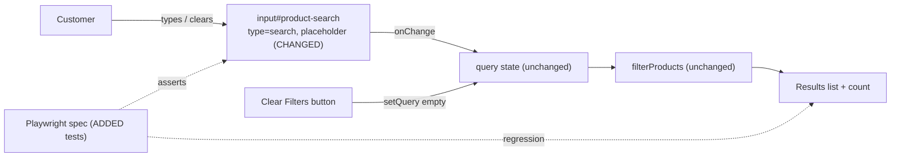

# Architecture: SCRUM-7 - Improve Product Search Placeholder

Source requirements: `output/SCRUM-7/docs/requirements.md` (status `READY_FOR_ARCHITECTURE`; FR-001..006, NFR-001..005, AC-001..005). Jira: https://epam-team-d41wx5ya.atlassian.net/browse/SCRUM-7.

Labels used below: **[REQ]** = backed by an approved requirement; **[ASSUMPTION]** = unconfirmed assumption (A-1..A-5 from requirements, not yet confirmed by the user); **[REC]** = design recommendation by this phase.

## 1. Overview and Goals

The change is a one-attribute text edit on an existing React input plus Playwright test coverage. There is no new component, module, dependency, data, or backend change [REQ FR-004, AC-005].

Goals:
1. The search input shows the placeholder `Search products by name...` when empty [FR-001].
2. Native placeholder behavior is kept: hidden while text is present, shown again when empty [FR-002].
3. Existing search, filter, count, empty-state, and Clear Filters behavior stays identical [FR-003, NFR-001].
4. A Playwright UI test verifies the placeholder [FR-005, FR-006].

Non-goals (from requirements): backend/database changes, `filterProducts` logic changes, label text changes, localization/styling of the placeholder.

## 2. Repository Evidence

| Evidence | Finding |
|---|---|
| `product-search/src/ProductSearchApp.jsx` lines 63-72 | `<label htmlFor="product-search">Search by name</label>` plus `<input id="product-search" type="search" value={query} onChange=... placeholder="Try “wireless”" />`. Controlled input; `query` state starts `""`; `clearFilters()` resets it to `""`. |
| `product-search/tests/product-search.spec.js` | Five existing test blocks plus a two-viewport loop. Locates the input by `page.getByRole("searchbox", { name: "Search by name" })`. Uses web-first `expect(...)` assertions and `toHaveAttribute` elsewhere (lines 9, 12-13, 98). No test asserts the current placeholder. |
| `product-search/playwright.config.js` | `testDir: ./tests`, Desktop Chrome (Chromium), `baseURL http://127.0.0.1:4173`, `fullyParallel: true`, and `webServer` runs `npm run dev` (reuses a server if not in CI). |
| `product-search/package.json` | `test:unit` = `vitest run`, `test:e2e` = `playwright test`. No lint script. `@playwright/test` 1.65.0, React 19.1.1, Vite 7.3.8. |
| Repo grep (excluding node_modules) for `placeholder` / `Try “` | The only occurrence of the old placeholder string is `ProductSearchApp.jsx:70`. No `::placeholder` CSS, no unit test, README, or spec references it. Supports A-3 and A-4. |

## 3. Components and Responsibilities

| Component | Change | Responsibility |
|---|---|---|
| `product-search/src/ProductSearchApp.jsx` (search `<input id="product-search">`) | **Modify** one attribute value | Renders the placeholder via the native `placeholder` attribute. |
| `product-search/tests/product-search.spec.js` | **Add** 1 or 2 test blocks | Browser-level verification of FR-001/002 (and FR-003 spot check). |
| `src/filterProducts.js`, `src/priceInput.js`, `src/data/products.json`, `styles.css`, label markup, `vitest` tests | **No change** | Search/filter logic and presentation stay as is [FR-003, FR-004, AC-005]. |

## 4. Design Decisions

### D-1. Production change [FR-001, FR-004, AC-001, AC-005]
In `ProductSearchApp.jsx` line 70, change only the attribute value:

`placeholder="Try “wireless”"` becomes `placeholder="Search products by name..."`

- Literal ASCII `...` (three full stops), no Unicode ellipsis, no surrounding quotes or backticks [ASSUMPTION A-2; matches the Jira text verbatim].
- Use a plain JSX string attribute (no constant, no helper, no i18n layer), consistent with the existing inline attribute style [NFR-004].
- Do not alter `id`, `type`, `value`, `onChange`, or the `<label>`. The accessible name continues to come from the label "Search by name" [NFR-003; ASSUMPTION A-1].

### D-2. Rely on native placeholder behavior [FR-002, AC-002]
The input is controlled, and `value` is `""` initially and after Clear Filters. The browser natively hides the placeholder when `value` is non-empty and shows it again when empty. No JavaScript, state, or CSS is added. `type="search"` does not alter this behavior. (Risk R-3 covers the editing/clearing edge.)

### D-3. No styling change [NFR-002; ASSUMPTION A-3]
No `::placeholder` rule exists today, so the browser default placeholder color/size is used. The new string is 27 characters, shorter than or comparable to the old one (16 characters plus quotes), so overflow risk is low. The existing 375x667 and 1366x768 reflow test (width within viewport, height >= 40px, no horizontal overflow) already asserts NFR-002 and must pass unchanged. A placeholder is clipped, not wrapped, in a text input and cannot increase page width.

### D-4. Accessibility [NFR-003; ASSUMPTION A-1]
A placeholder is not used as the accessible name when a `<label>` exists, so keeping the label preserves the name "Search by name". The placeholder is a hint only and does not replace the label. This is also what keeps the existing `getByRole("searchbox", { name: "Search by name" })` locators valid [REC: verified indirectly by the new tests using the same locator].

### D-5. No backend or data changes [FR-004, NFR-005, AC-005]
No API, storage, data file, logging, config, or security surface is touched. Security, privacy, performance, and observability: not applicable (static string attribute, no data handling) [NFR-005].

## 5. Test Design

### 5.1 Placement and conventions [FR-005, AC-004; ASSUMPTION A-5]
Add tests to the existing `product-search/tests/product-search.spec.js` (same file, same `@playwright/test` import, same `page.goto("/")` pattern, `fullyParallel`-safe because each test has its own page and no shared state). Run via `npm run test:e2e` (Chromium). No new config, helper, fixture, or dependency [NFR-004].

### 5.2 Locator strategy
- Primary locator: `page.getByRole("searchbox", { name: "Search by name" })`, identical to existing tests. It uses accessible role/name, not CSS id or placeholder text. This also proves that the accessible name is unchanged [NFR-003].
- Do not use `getByPlaceholder(...)` as the sole locator for the behavior tests: it would disappear from the match once text is typed (placeholder is still an attribute, so it would still match, but role/name is the stable convention and decouples locator from the value under test).
- Exact-match assertion: `toHaveAttribute("placeholder", "Search products by name...")` with a string argument performs a full, case-sensitive equality check (not a substring), satisfying the "exactly" wording of AC-001 [A-2].

### 5.3 Proposed test cases (to be elaborated in the implementation plan)

**T-1: shows the placeholder on an empty search box** [FR-001, FR-005, AC-001, AC-004]
1. `page.goto("/")`.
2. `search = getByRole("searchbox", { name: "Search by name" })`.
3. `await expect(search).toHaveValue("")`.
4. `await expect(search).toHaveAttribute("placeholder", "Search products by name...")`.
5. Real-browser rendering check (see 5.4): assert the placeholder is currently shown.

**T-2: hides the placeholder while text is entered and restores it when cleared** [FR-002, FR-006, AC-002]
1. `search.fill("wireless")`; assert the placeholder is **not** shown (see 5.4); assert result count changed (for example `getByRole("article")` count 2, matching existing behavior at line 27) as a light FR-003 spot check.
2. `search.fill("")` (or `search.clear()`); assert the placeholder is shown again and all 12 products are listed.
3. Optional additional step [A2 flow]: type text, click `Clear Filters`, assert the placeholder is shown again. This may live in T-2 or be skipped, since the existing Clear Filters test already asserts `toHaveValue("")`; decide in the implementation plan. [REC]

Existing tests are not modified. They cover filtering/clear regression (FR-003): the AND-semantics/clear test (lines 19-43), the empty-state test (84-90), and the viewport test (101-130).

### 5.4 Verifying "placeholder is displayed / not displayed"
The `placeholder` attribute remains in the DOM even when text is typed, so `toHaveAttribute` alone cannot prove "disappears" (AC-002). A genuine browser-state check is needed. Options evaluated:

| Option | Mechanism | Verdict |
|---|---|---|
| **A [REC]** | `:placeholder-shown` pseudo-class: `await expect.poll(() => search.evaluate((el) => el.matches(":placeholder-shown"))).toBe(true/false)` | Chosen. Real Chromium state (true only when a placeholder exists and the value is empty). Supported in Chromium; project runs Chromium only. `expect.poll` gives auto-retry, consistent with the existing `evaluate` usage at lines 52, 57, etc. |
| B | Locator with CSS pseudo-class: `page.locator("#product-search:placeholder-shown")` with `toHaveCount(1/0)` | Equivalent and fully web-first, but uses the CSS id rather than role/name. Acceptable fallback if reviewers prefer retry semantics without `expect.poll`. |
| C | Assert `toHaveValue("wireless")` / `toHaveValue("")` only | Proves value state only, not placeholder rendering. Use as a supporting assertion, not as the sole proof. |
| D | Screenshot / visual compare | Rejected: brittle across environments, no existing snapshot convention, disproportionate. |

Both A and B check browser-computed state, not implementation internals, so they would fail if someone changed the input to a non-native fake placeholder.

## 6. Regression Strategy [FR-003, NFR-001, NFR-002, AC-003]

1. Run the full unit suite `npm run test:unit` (unchanged tests must pass; none reference the placeholder).
2. Run the full Playwright suite `npm run test:e2e`; all pre-existing tests must pass unmodified, with the new tests added alongside.
3. Run `npm run build` as a compile sanity check (CLAUDE.md lists it as a project command).
4. Diff review for AC-005: the production diff must be exactly one line in `ProductSearchApp.jsx`; no changes to `src/filterProducts.js`, `src/priceInput.js`, `src/data/products.json`, `styles.css`, or the label. The tests diff is limited to `tests/product-search.spec.js`.
5. Optional (non-required) hardening: a quick search of the repo for the old string `Try “wireless”` should return no hits after the change.

## 7. Error Handling, Logging, Configuration, Deployment

- Error handling: none introduced. A nonmatching search keeps showing "No products found" [FR-003].
- Logging/observability/configuration: none added [NFR-005].
- Deployment/runtime: ships with the normal Vite build of the SPA. No migrations, flags, or environment variables. Rollback is a one-line revert.

## 8. Traceability Matrix

Chain: Source -> Requirement -> Architecture decision/component -> (IMP task: not yet assigned) -> Code -> Test -> Verification (pending).

| Requirement | AC | Architecture decision / component | Code location | Planned test | IMP task / verification |
|---|---|---|---|---|---|
| FR-001 | AC-001 | D-1; `ProductSearchApp.jsx` input | `ProductSearchApp.jsx:70` | T-1 (attribute equality + placeholder shown) | Pending phase 4 / 7 |
| FR-002 | AC-002 | D-2 (native behavior) | none (no code) | T-2 (`:placeholder-shown` false then true) | Pending |
| FR-003 | AC-003 | D-1 scope limit; unchanged modules | none | Existing tests unchanged (lines 19-43, 84-90, 101-130) plus count spot check in T-2; `npm run test:unit` | Pending |
| FR-004 | AC-005 | D-1, D-5 | single-line diff | Diff review (section 6.4) | Pending |
| FR-005 | AC-004 | Section 5.1-5.3 (T-1) | `tests/product-search.spec.js` | T-1 | Pending |
| FR-006 | AC-002, AC-003 | Section 5.3-5.4 (T-2) | `tests/product-search.spec.js` | T-2 | Pending |
| NFR-001 | AC-003 | Section 6 | none | Full unit + E2E runs | Pending |
| NFR-002 | AC-001 | D-3 | none | Existing viewport tests (375x667, 1366x768) pass unchanged | Pending |
| NFR-003 | AC-001 | D-4 (label retained) | `ProductSearchApp.jsx:64` untouched | T-1/T-2 and existing tests use `getByRole("searchbox", { name: "Search by name" })` | Pending |
| NFR-004 | AC-003, AC-005 | D-1 (inline string, no new tooling) | single-line diff | Diff review | Pending |
| NFR-005 | AC-005 | D-5 (not applicable) | none | Not applicable (explicitly out of scope) | n/a |

No requirement lacks a design decision. FR-002 has no production code by design (native behavior), so its coverage rests entirely on T-2.

## 9. Alternatives Considered

| Alternative | Reason rejected |
|---|---|
| Custom JS/CSS placeholder (overlay or ``) | Contradicts "standard placeholder behavior" (FR-002), adds code/accessibility risk, violates minimality (NFR-004). |
| Use `aria-label` or move the hint into the label text | Out of scope (A-1, NFR-003); would change accessible name and break existing locators. |
| Extract placeholder text to a constant or i18n resource | Over-engineering for one static string; localization is out of scope (A-3). |
| Add a Vitest/jsdom component test | Repo has no React Testing Library and no component unit tests; jsdom would not evaluate `:placeholder-shown` faithfully. The story explicitly requires Playwright. Not adding dependencies. |
| Separate new spec file | Existing single-file suite convention (A-5); no benefit. |
| Visual snapshot test | Brittle and without existing snapshot convention (see 5.4 D). |

## 10. Risks

| ID | Risk | Likelihood / impact | Mitigation |
|---|---|---|---|
| R-1 | Typo or Unicode ellipsis in the string breaks the exact match. | Low / Medium | Exact string equality in T-1 (full-match `toHaveAttribute`); A-2 to be confirmed. |
| R-2 | Tests asserting only `placeholder` attribute give false confidence for "disappears". | Medium / Low | Use `:placeholder-shown` browser state (5.4 A) in T-2. |
| R-3 | `fill("")` on a search input is handled differently from user deletion in some edge cases. | Low / Low | Playwright `fill`/`clear` dispatches input events that React `onChange` handles; existing test already uses Clear Filters to reset. If flaky, use `clear()` or a keyboard `Backspace` sequence. |
| R-4 | `:placeholder-shown` is browser-specific. | Low / Low | Config runs Chromium only; Chromium supports it. If more browsers are added later, support is broad in modern engines. |
| R-5 | Another change in flight modifies the same line or the spec file (merge conflict). | Low / Low | Working on isolated branch `sdlc/SCRUM-7`; minimal diff. |

## 11. Assumptions and Open Questions

Carried forward unchanged and **unconfirmed by the user** (non-blocking):

| ID | Assumption | Effect on this design |
|---|---|---|
| A-1 | Label "Search by name" and `id="product-search"` unchanged; accessible name stays. | Test locators use role/name "Search by name". If the label changes, locators and D-4 need revisiting. |
| A-2 | Placeholder is the ASCII string `Search products by name...`, no quotes or backticks. | Exact string in D-1 and T-1. |
| A-3 | No styling change needed. | D-3. No CSS edit. |
| A-4 | Old placeholder is replaced, not referenced by tests. | Verified by repo grep (section 2). |
| A-5 | Tests go in the existing spec file and run under Chromium via `npm run test:e2e`. | Section 5.1. |

Design-phase recommendations (not requirements, for plan/review to accept or reject):
- [REC] Use `:placeholder-shown` as the real-browser check (5.4 option A); option B is an acceptable equivalent.
- [REC] Include the Clear Filters alternate flow (A2) inside T-2 only if it stays small; otherwise leave to existing coverage.

Open questions: Q-1 from requirements (confirm A-1..A-5) remains the only one. No design question blocks implementation, and no user decision is required from this phase.
